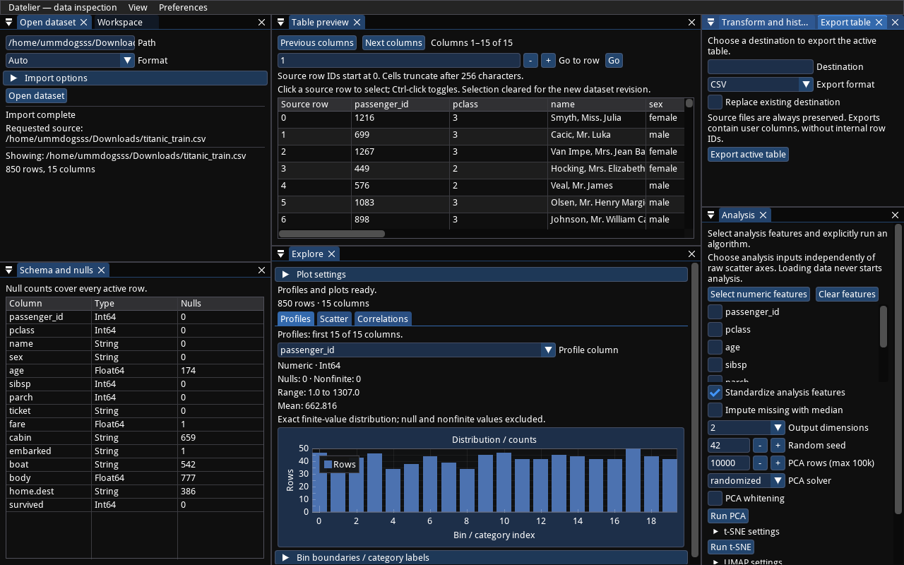
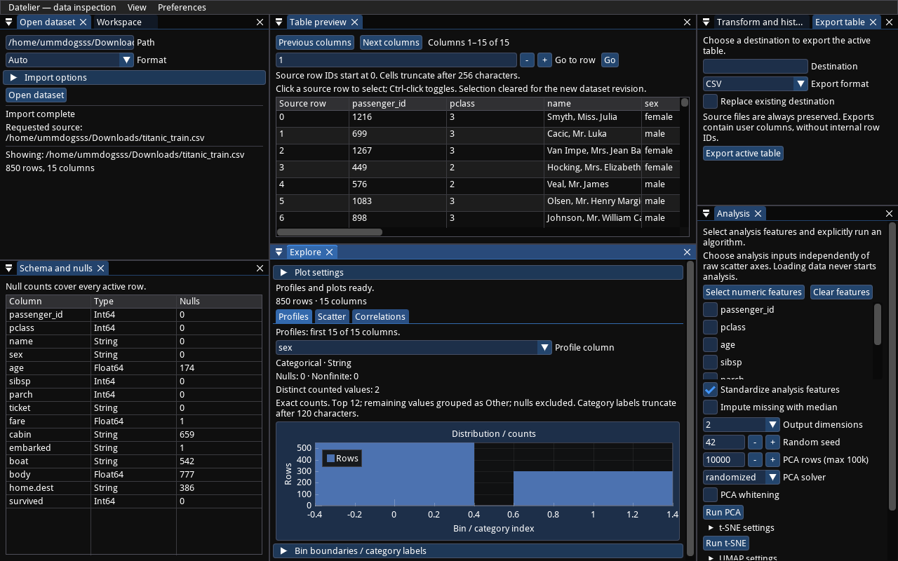
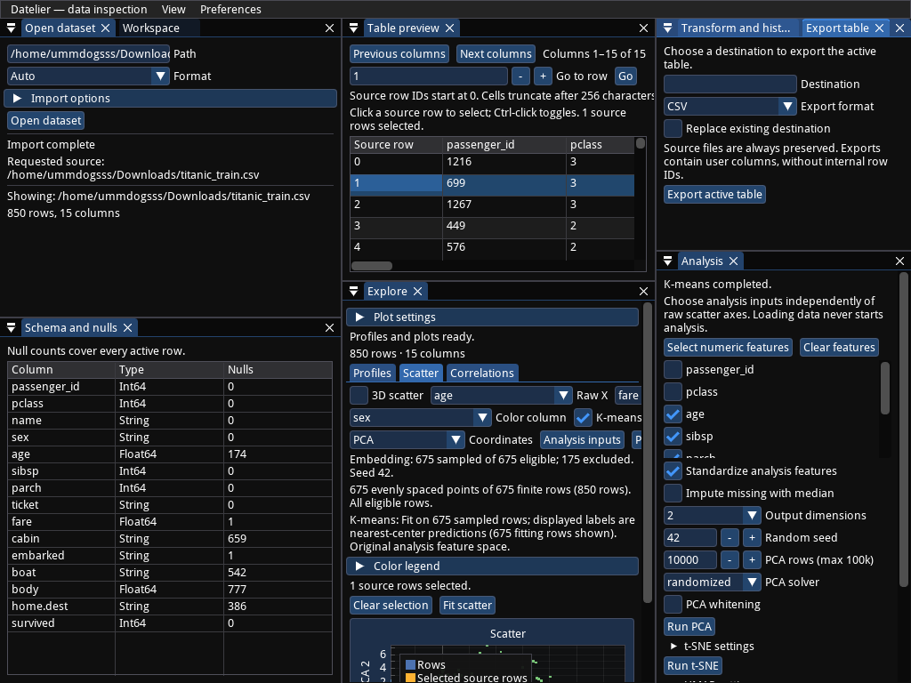

# Titanic UX review and proposed repair plan

Reviewed **2026-10-04**, against repository revision `e61fce7`, using
`/home/ummdogsss/Downloads/titanic_train.csv`.

## Assessment

Your criticism is justified. Datelier has useful capabilities, but its current
interface makes ordinary inspection harder than it should be. My qualitative
rating for everyday inspection is **4/10**: importing and computing work well;
finding, configuring, and reading the results require too much effort. This is
an expert assessment from one dataset, not a measured user-study score.

The main problem is the default working arrangement. The interface exposes
import, schema, table, transformation/export, exploration, and analysis at once,
with little hierarchy. Controls consume space that the data needs. Several
charts also use representations that conceal the meaning of the values.
Changing colors or trimming a few sentences will not resolve those problems.

The recommended direction is **one inspection workspace with a large chart,
shared column context, a resizable table, and settings next to their result**.
Keep docking as customization. Make the default arrangement useful without
requiring the user to learn docking first.

## What I actually tried

This file contains **850 rows and 15 columns**, rather than the often-used
891-row Titanic training table. It includes `boat`, `body`, and `home.dest`.
No assumptions about another Kaggle version were used for the counts below.

I ran the production GUI on Linux with Mesa software OpenGL, inspected actual
rendered screenshots, and exercised production state/jobs through temporary
frame hooks and some injected pointer events. The review used the default
layout with preference saving disabled, preserving your saved preferences.
It is a GUI walkthrough and code-informed review, not a physical-click-only
usability test. Captured window sizes were 1280×800, 1600×998 (requested
1600×1000), and 1024×768.

| Task | Observed result |
| --- | --- |
| Import and preview the CSV | 850×15 loaded; first prepared preview about 122 ms in the initial run. This is one run, not a performance benchmark. |
| Inspect `sex` and category labels | Correct counts, 551 male / 299 female; chart axes display numeric indices, with names hidden below the chart. |
| Inspect numeric distributions | Individual profiles render index-based histograms. Age KDE and ECDF both render through numeric comparison settings. |
| Inspect suggested/custom scatter | Default suggestion is `passenger_id` / `pclass`; custom `age` / `fare`, colored by `sex`, contains 675 finite pairs. |
| Inspect relationships | Heatmap and eight-feature distribution/scatter grid render; labels and grid cells are difficult to read at the default size. |
| Run PCA explicitly | `age`, `fare`, `sibsp`, `parch`; standardized, no imputation, 2D, seed 42. 675 eligible rows, 175 excluded; fit runtime about 0.17 s, excluding worker startup. |
| Run k-means explicitly | Same four features and preprocessing; 3 clusters. 675 fitting rows; fit runtime about 0.21 s, excluding worker startup. Cluster colors appear on the PCA view. |
| Check linked highlighting | Setting source-row selection to row 1 highlights the table row and the prepared scatter/embedding overlay. This verifies linkage, not gesture discoverability. |
| Sort/filter/undo/redo | Fare descending preserved source identity; filtering `sex == female` produced 299 rows, undo restored 850, redo returned to 299. |
| Resize | Larger and narrower windows render; narrow controls and plots clip. A separate resize-only workflow completed successfully. |

The completed transformation run verified identical source SHA-256 hashes
before and after. No application source or dependencies changed during this
review. The Titanic CSV is not included in the repository.

t-SNE/UMAP controls, workspace controls, and export controls were reviewed in
code; this audit did not run t-SNE/UMAP, save/reopen a Titanic workspace, or
perform an export round-trip. Those are outstanding checks for any redesign.

Evidence: [structured audit](evidence/titanic-ux/audit.json),
[completed workflow and source hashes](evidence/titanic-ux/workflow.json).

## Findings

**P1** means fix in the first UX repair sequence: the issue obstructs a basic
task or makes a result hard to interpret. **P2** means a meaningful subsequent
improvement. These are UX priorities, not data-loss severity claims.

| # | Priority | Finding and consequence | Proposed behavior |
| --- | --- | --- | --- |
| 1 | P1 | **Fragmented default workspace.** Explore is separated from Analysis; import remains large after loading, and editing/export competes with inspection. The default 607-pixel-wide center shows only seven table rows. | One primary inspection canvas; compact dataset toolbar; column sidebar; resizable table; contextual analysis/transform settings. |
| 2 | P1 | **Plots do not use available space.** Individual profiles are fixed at 170 px, comparisons at 220 px, and 2D scatter is capped at 220 px with a 150 px floor. More controls can push the chart below the viewport. | Fill the available chart region, expose a visible table/chart divider and an **Expand chart** action, and adapt controls when width shrinks. |
| 3 | P1 | **Axes hide the values.** `sex` has fractional numeric ticks; age histograms show bin numbers rather than ages. Category names/bin boundaries require a separate disclosure. | Category names directly on bars; horizontal bars for long labels. Numeric histograms use real bin boundaries on the x-axis; temporal plots use formatted dates/times. |
| 4 | P1 | **Histogram/KDE/ECDF switching is indirect.** The switch appears as “Numeric comparison” only after selecting comparison columns in Plot settings. A chosen numeric profile has no equivalent switch. | An always-visible **Chart type** selector for the selected column: Histogram, KDE, ECDF, Box, Violin. Show Counts for categorical fields. |
| 5 | P1 | **Storage types dictate analytical meaning.** `pclass` and `survived` become continuous numeric profiles; the first profile is `passenger_id`. Suggested scatter prioritizes the ID/class relationship. | Separate storage type from editable inspection role: continuous, discrete/ordinal, category, identifier, temporal. Suggest roles conservatively; let users override them without casting the source. |
| 6 | P1 | **Analysis controls and results disagree visually.** A PCA result retains Raw X/Y controls, “Update raw scatter,” and an `age / fare` suggested-scatter selector. PCA settings remain in another pane. | A single coordinate-source control: Raw / PCA / t-SNE / UMAP. Show axes and settings appropriate to that source, with analysis features and Run beside the result. |
| 7 | P1 | **Errors can be outside the visible panel.** Running PCA with no features sets “Choose 1–128 distinct numeric analysis features,” but the error is appended below the long controls. | Validate beside the feature selector; keep actionable errors and job status visible. Disable Run until prerequisites hold and show the missing prerequisite there. |
| 8 | P1 | **Control rows clip at smaller widths.** At 1024×768, the Explore pane is about 351 px wide; raw-axis and analysis-button rows extend past its edge. The chart is partly below the viewport. | Measure available width and wrap/switch to stacked controls. Use a drawer or settings tab when a side inspector cannot fit. |
| 9 | P1 | **The effective color encoding is unclear.** A `sex` color dropdown remains selected while a separate k-means checkbox overrides it. Category/cluster names live in a collapsed legend. | One **Color by** selector, including available clustering results; persistent compact legend showing the active encoding. |
| 10 | P2 | **Labels and hierarchy are weak.** Many field labels are right of the input; headings, explanatory text, and metadata have almost identical size/weight. Group ownership is unclear. | Left-aligned labels above fields or in a consistent label column; stronger section titles; muted secondary metadata; spacing that groups related controls. |
| 11 | P2 | **Routine help dominates the work area.** Repeated explanations cover source IDs, gestures, source protection, independent inputs, and resource caps. Comparison views show a long sampling paragraph even for a small dataset. | Show a concise, actual-result summary. Move examples/gestures/technical limits to contextual help and expandable Details. Keep active errors, sampling, and excluded-row counts visible. |
| 12 | P2 | **Column context is disconnected.** Schema rows do not select a profile. Transformations require typing column names, selecting columns via JSON, and mappings via JSON pairs. | Share the selected column between sidebar/profile/transform controls; searchable column pickers and checkbox selection; key/value rows for mappings. Keep expressions constrained. |
| 13 | P2 | **Table inspection is awkward.** Names clip without a full-cell inspector; only the source-row cell selects the row. Previous/Next columns remain available when all 15 columns are already in the current column page. Sorting is elsewhere. | Full-cell tooltip/inspector, row selection across cells, header sorting/menus, disabled inapplicable navigation, and a column visibility picker. Keep internal row identity stable. |
| 14 | P2 | **Missingness is a number without enough context.** Schema gives null counts, but no percentages or visual comparison. Profiles omit nulls from bars; the important exclusion information competes with generic text. | Show missing count and percentage beside the column, optionally include Missing in categorical counts, and provide a direct missing-value action. |
| 15 | P2 | **Relationship defaults exceed the readable area.** The eight-feature grid is at least 960 px tall and replaces names with feature numbers; only its top rows fit. Heatmap x-labels crowd together. | Start with a small readable feature set; expose selection/order; provide Expand matrix and drill-down. Use names on outside axes, adaptive labels, and a visible color scale. |
| 16 | P2 | **Routine file actions require path syntax.** Open, workspace, and export use text paths; the source path is repeated after import and input fields show only a small part of it. | Browse/Open/Save dialogs with explicit destinations, a compact dataset name, and a full-path tooltip. Put workspace/export actions in the main toolbar/menu. |
| 17 | P2 | **Natural grouped questions have no direct workflow.** “How does survival vary by sex/class?” cannot be answered directly with a grouped rate chart or cross-tab. Numeric comparisons select different columns, rather than comparing one measure across categories. | Add category counts/percentages, category×category cross-tabs, and numeric distributions grouped by a category, with explicit denominators and sample sizes. |
| 18 | P2 | **Linked-selection gestures are hidden.** Selection works, but brushing depends on Shift-drag and pan on middle-drag, described in a disclosure. Scatter does not give a passenger/value tooltip. | Visible Select / Brush / Pan modes, selected-row count, **Show selected rows**, Clear, and point tooltips with values plus stable row reference. |

### Screenshots that explain the problems

Default layout: large persistent side panes, seven table rows, right-side field
labels, and an identifier histogram with index ticks.



Categorical profile: the values are male/female, but the visible axis runs from
approximately −0.4 to 1.4. The counts are correct; the presentation is wrong.



Narrow layout after PCA/k-means: controls extend beyond the Explore pane, both
`sex` and k-means appear to control color, and the chart extends below the screen.



Additional captures: [default scatter](evidence/titanic-ux/scatter-default.png),
[age KDE](evidence/titanic-ux/kde.png),
[PCA at 1600×998](evidence/titanic-ux/pca.png),
[eight-column pair grid](evidence/titanic-ux/pair-grid.png).

### Clarifications on your specific observations

- Explore and Analysis are docked panels, rather than separate application
  pages, but they still split one analytical task across two distant places.
  Merging the interaction is the right direction; the computation modules can
  remain separate.
- Dock separators can change panel sizes. There is no obvious chart resize or
  focus action, and the chart height caps mean enlarging a panel is insufficient.
- KDE/ECDF already exist. The first repair is exposing them in the ordinary
  single-column workflow, not adding another distribution implementation.
- Many **field labels** are right-aligned relative to their inputs. Plot titles
  are generally centered, not on the right. The remedy is left-aligned section
  titles/field labels and clear type hierarchy, rather than moving every axis
  annotation to the left.
- Removing all explanation would remove useful trust information. Keep actual
  sampling, exclusions, errors, and provenance accessible; remove repeated
  instructions from the default reading path.

### Titanic-specific analytical pitfalls

This dataset exposes why storage type alone is insufficient. `survived` has two
values and `pclass` three; `passenger_id` is unique. Their useful default views
are discrete counts/categories or an identifier summary, rather than continuous
histograms/KDE. Low cardinality should be a suggestion, not an automatic rule:
counts such as `sibsp` can still be numeric.

The “Select numeric features” action includes `passenger_id`, `body`, and
`survived`. That is a poor default for an analysis of pre-voyage passenger
attributes. `boat` and `body` appear to describe rescue/body-recovery outcomes;
this semantic reading should be confirmed against this file's data dictionary.
The application should offer explicit user-controlled roles/exclusions, not
hard-coded Titanic column names or universal “correct” features.

As a useful acceptance question, the file's survival rates are approximately
**70.2% female versus 18.7% male**, and **60.7%, 45.8%, 23.4%** for classes 1, 2,
3. These were calculated separately with Polars to establish expected results;
Datelier did not produce those grouped summaries in this walkthrough.

Missingness also deserves stronger presentation: age 174/850 (**20.5%**), cabin
659/850 (**77.5%**), and body 777/850 (**91.4%**). For the age/fare scatter and
four-feature analyses, show **675 included · 175 excluded** with an exclusion
breakdown, rather than making users interpret “finite” and “eligible” prose.

### Native focus failure requiring investigation

Two instrumented runs exited with native status 139 when a frame hook called
`imgui.set_window_focus("Transform and history")` while that dock tab was
inactive. A fresh run with the same requested 1600×1000 → 1024×768 → 1280×800
resize sequence, omitting the focus injection, completed sort/filter/undo/redo.

This isolates an injected-focus failure, not a confirmed normal-user resize
crash. Reproduce through actual tab/focus controls before assigning cause.
Also check **Analysis inputs**, whose implementation uses the same focus API,
with the Analysis tab active, inactive, and hidden. Keep this gate open.

## Proposed interaction and layout

At 1280×800, use a compact top toolbar, a roughly 220 px column sidebar, a
large central inspection area, and a roughly 280 px contextual settings pane.
The table is a resizable bottom region. At narrower widths, settings become a
drawer/tab rather than squeezing the chart. Table focus and Chart focus are
explicit actions; each retains the user's settings and selection.

```text
Dataset: titanic_train.csv   850 rows · 15 columns   Open   Save   Export
┌──────────────────┬─────────────────────────────────┬───────────────────┐
│ Columns          │ Distribution   Relationships    │ Current view      │
│ Search…          │                                 │                   │
│ passenger_id  ID │ Age                             │ Column            │
│ pclass  Category │ Chart type [Histogram ▾]         │ [age ▾]           │
│ sex     Category │                                 │ Group by          │
│ age      Numeric │                                 │ [None ▾]          │
│ 174 missing      │         Large readable chart    │                   │
│ fare     Numeric │                                 │ Analyze…          │
│ …                │ 676 included · 174 missing      │ Transform…        │
├──────────────────┴──────── visible resize divider ┴───────────────────┤
│ Table    0 selected     Show selected rows       Filter    Table focus │
│ passenger_id   pclass   name   sex   age   fare   …                     │
└───────────────────────────────────────────────────────────────────────┘
```

For scatter, **Coordinates** selects Raw/PCA/t-SNE/UMAP. Raw shows X/Y/(Z).
An embedding shows its components and an **Analysis settings** drawer containing
selected input features, preprocessing, algorithm, and Run. **Color by** selects
one effective encoding. Features remain independent of raw axes, but that
independence is apparent in the control structure. Loading/restoring still
never starts ML; explicit Run remains required.

For distributions, selecting `age` immediately exposes Histogram/KDE/ECDF/Box/
Violin. Selecting `sex` exposes Counts with visible category labels. **Compare
columns** is an optional extension of the same chart. **Group by** is a distinct
capability: comparing age across sex groups is different from overlaying age
and fare. Incompatible options should be unavailable with a local explanation.

Use one restrained style system: 18 px section titles, 13–14 px labels/body,
12 px secondary metadata, left alignment, about 12 px pane padding, 8 px within
a control group, and 20–24 px between groups. Titles should stand out by size
and weight; selected state and errors should stand out by purpose. Retain the
existing theme choices. This is a legibility repair, not a decorative redesign.

## Bounded implementation sequence

These are **proposed, unimplemented steps**. Keep the existing typed Polars,
revision-aware workers, replayable pipeline, and persistence boundaries. Do not
rewrite the data engine to repair the presentation.

### 1. Make single-column charts understandable

Deliver real numeric/date coordinates and directly labelled categorical bars;
expose the single-column chart-type selector; show a compact included/missing
summary. Reuse the existing distribution preparation for KDE/ECDF. Display
ordinary numeric histograms in value space, preserving nonuniform bin widths
and count/density meaning. Handle constant/all-null columns explicitly.

Primary areas: [profile rendering](../src/datelier/gui/exploration.py),
[comparison rendering](../src/datelier/gui/plots/distributions.py),
[prepared bars](../src/datelier/plotting/scatter/prepare.py),
[profiles](../src/datelier/inspection/profiles.py),
[distribution preparation](../src/datelier/plotting/distributions/numeric.py).

Gate: `sex` shows named bars with 551/299 counts without opening help; age
switches Histogram → KDE → ECDF without configuring a comparison; age axis
shows ages, and its 174 missing values remain accounted for. Behavioral checks
cover ties, constants, all-null columns, temporal values, and category overflow.

### 2. Give charts usable space

Remove fixed/capped chart heights; introduce an explicit chart region, visible
resize divider, and chart/table focus actions. Keep important controls above
the chart without forcing them onto one line. Establish minimum readable size
and a compact fallback rather than drawing clipped charts.

Primary areas: [docking layout](../src/datelier/gui/layout.py),
[2D scatter](../src/datelier/gui/plots/scatter.py),
[3D scatter](../src/datelier/gui/plots/scatter3d.py), and distribution/relationship
renderers.

Gate: at all three reviewed sizes, primary controls and full plot axes are
reachable without horizontal clipping. At 1280×800, Chart focus gives the plot
at least 340 px height including its axes; Table focus shows at least ten rows.
Dragging the divider visibly resizes the plot, and expanded view preserves
zoom/selection. Verify 2D, 3D, distributions, heatmap, and grid independently.

### 3. Unify exploration and analysis controls

Build the shared column context and contextual view-settings pane/drawer.
Relocate optional import/edit/export controls out of the default canvas.
Use one coordinate-source selector and one color selector; eliminate competing
raw controls on embedding views. Keep feature selection explicit, preview
included/excluded rows before fitting, and make errors visible beside Run.

Primary areas: [GUI orchestration](../src/datelier/gui/app.py),
[analysis view](../src/datelier/gui/analysis/session.py),
[analysis controls](../src/datelier/gui/analysis/controls.py),
[plot controls](../src/datelier/gui/plots/controls.py), and layout.

Gate: select the four audited features, run PCA, inspect its result/provenance,
switch back to raw age/fare, and choose sex/cluster colors within one inspection
context. Empty features give visible guidance before running. Changing analysis
settings visibly marks the previous fit as needing rerun. No load/restore runs ML.
Complete the inactive/hidden-tab focus investigation before claiming this gate.

### 4. Apply hierarchy, grouping, and concise feedback consistently

Introduce small shared GUI primitives for labelled fields, section headings,
compact status, and contextual help. Apply the spacing/type rules across
inspection, analysis, transforms, import, export, and workspaces. Keep current
values near their controls. Make ordinary plot changes update automatically
through coalesced revision-aware jobs; show Updating while old results remain.
Keep transforms, exports, and ML as explicit commands.

Gate: no routine gesture/resource paragraph is expanded by default; actual
sampling/exclusions and errors remain visible. Labels and titles share consistent
left alignment; related fields form clear groups. Controls wrap at narrow widths.
Worker behavior rejects stale changes and does not recompute continuously while
the user drags a slider.

### 5. Add editable inspection roles

Add explicit column inspection roles and optional value labels as view metadata,
separate from Polars dtypes. Suggest identifier/discrete/category roles and let
users accept/override them; exclude identifiers from automatic chart suggestions.
Persist these choices in a versioned workspace with backwards-compatible
defaults. Keep identifiers out of the numeric-feature bulk-selection default;
allow their explicit inclusion. Role suggestions must remain overridable.

Gate: user can present `pclass`/`survived` categorically without mutating source
values; workspace restore preserves that choice. `passenger_id` no longer
dominates suggestions. Verify role overrides, unavailable columns on relink,
old-workspace defaults, and explicit inclusion of an identifier in analysis.

### 6. Answer grouped inspection questions

Add category cross-tabs/count or percentage bars and category-grouped numeric
distributions, with visible denominators and missing-value policy. Reuse the
single-column chart controls; preserve group identities for linked selection.

Gate: sex/class survival charts match the rates above and show group sample
sizes. Grouped age distributions support the same relevant chart types, with
resource limits and selection semantics specified. Recheck bounded preparation
on wide and large fixtures and small/missing-only groups.

### 7. Make table and transformations direct

Connect column selection to profiling and transformations; add header sorting,
row/cell inspection, graphical column selection/mapping editors, and visible
selection modes. Provide an inline impact preview for filters and missing-value
actions before committing a reversible operation.

Primary areas: [table](../src/datelier/gui/data/table.py),
[operations](../src/datelier/gui/data/operations.py),
[transforms](../src/datelier/gui/data/transforms.py), and selection rendering.

Gate: filter to female passengers, undo/redo, inspect an untruncated name, and
brush points and show the matching rows. Preserve row identity after sorting
and filtering; verify mappings and missing-value edits without JSON input.

### 8. Make file and workspace actions familiar

Add Open/Save dialogs and compact toolbar/menu actions; retain typed paths.
Preserve explicit destination/overwrite choices and source protection. Save
the new view preferences with the existing referenced-workspace contract.

Primary areas: [import](../src/datelier/gui/data/import_controls.py),
[export](../src/datelier/gui/data/export.py),
[workspace](../src/datelier/gui/workspace/controls.py), and GUI menus/preferences.

Gate: export to a new destination, save/reopen the workspace, and relink a moved
source. Verify dialog cancellation, failure, and overwrite behavior; restored
roles, chart types, layout, and settings; source hashes; and no silent ML.

For **every implementation step**, run batch Pyrefly, relevant behavioral tests,
Ruff lint/format, and GUI smoke checks; fix failures, review, and commit before
starting the next step. At completion, run the full suite and record fresh
Titanic plus synthetic large/wide GUI evidence. Existing v1 feature gates remain
passed; this proposal does not claim that new UX gates have passed.

## Final usability acceptance

Repeat these tasks with actual pointer/keyboard input and no README or expanded
help. First record the current baseline; the targets below are proposed targets,
not timings measured in this audit.

1. Open the CSV and identify its size and age missingness within 30 seconds.
2. Show sex counts with readable labels within 15 seconds of loading.
3. Switch age between Histogram/KDE/ECDF in one control change per switch.
4. Enlarge a chart within 5 seconds; resize it without losing the current view.
5. Produce age/fare colored by sex within 30 seconds; see the legend immediately.
6. Answer survival by sex/class within 30 seconds once roles are configured.
7. Run PCA with explicit features; see exclusions, completion, and the result in
   the same working context, without irrelevant raw-coordinate controls.
8. Filter, undo/redo, brush points, and locate selected table rows without help.
9. Save/reopen and export with clear destination choices; verify source hashes
   and row linkage, no silent ML, and recovery after failure/cancellation.
10. Repeat at the three window sizes and through all themes; no essential control,
    category label, error, or plot axis should become inaccessible.

The first priority is steps **1–3**. They repair interpretation, space, and the
split workflow. The remaining steps make the tool efficient for repeated use.
